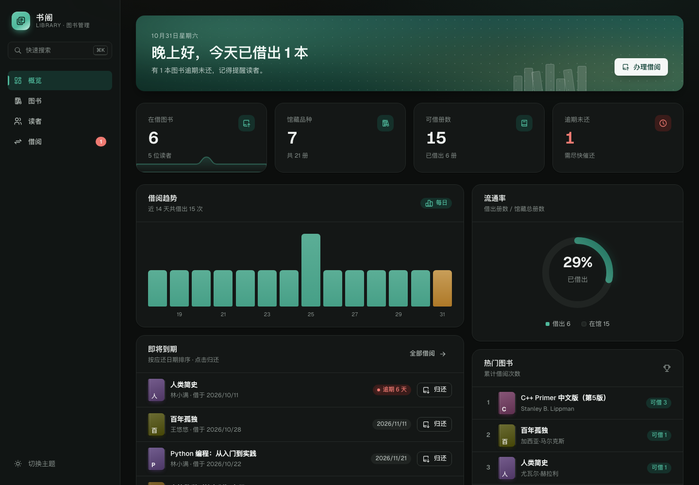
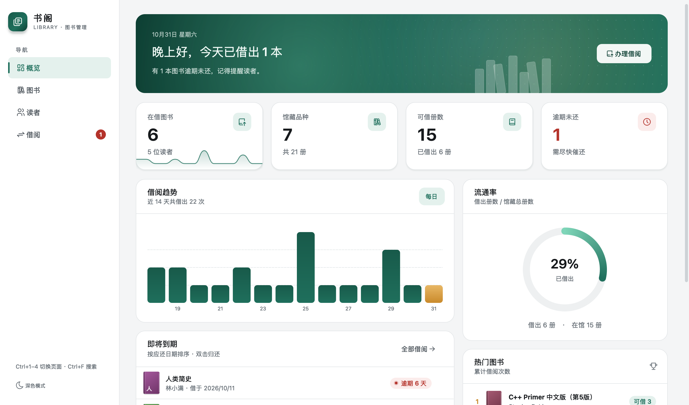
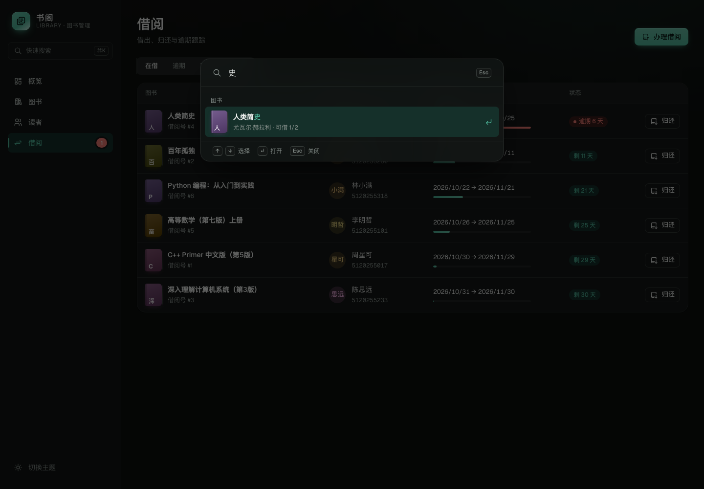
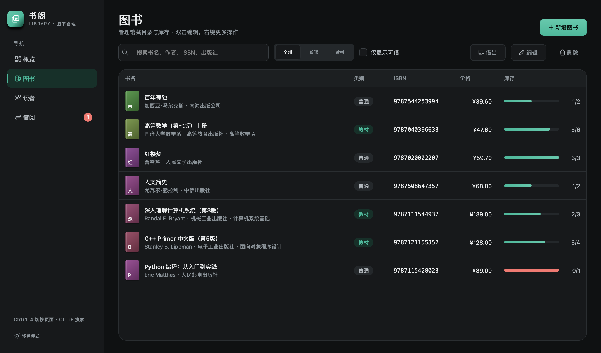

# 书阁 · 图书管理系统

一个用现代 C++20 重写的图书管理系统，共享同一套业务核心，提供 **Web** 与 **Qt 桌面** 两个前端，数据持久化在 **SQLite**。

| Web 版 | Qt 桌面版 |
| --- | --- |
|  |  |
|  |  |

## 功能

- **图书**：增删改查、按书名/作者/ISBN/出版社搜索（结果高亮）、普通/教材分类、仅看可借；ISBN-10/13 校验位校验。
- **读者**：增删改查，每人最多同时借 5 本，可视化额度条。
- **借阅**：借出（自定义天数）、归还、逾期追踪；有逾期未还时禁止继续借书；同一本书不能重复借。
- **概览**：问候横幅、动态统计卡片（数字滚动 + 迷你折线）、近 14 天借阅柱状图、流通率圆环、热门图书排行、即将到期列表。
- **体验**：浅色/深色主题、全键盘操作（Web：`⌘K` 命令面板、`/` 聚焦搜索；Qt：`Ctrl+1–4` 切页、`Ctrl+N` 新建、`Ctrl+F` 搜索、`Delete` 删除）。

### 动效一览

| | Web | Qt |
| --- | --- | --- |
| 页面切换 | View Transitions API 淡入上移 | 旧页面快照淡出 |
| 主题切换 | 从点击处圆形扩散揭示 | 全窗口快照交叉淡化 |
| 导航 | 指示条弹性滑动 | `SlidingIndicator` 弹性滑动（OutBack） |
| 分段控件 | 滑块跟随 | 滑块弹性跟随 |
| 列表 | 行依次浮现、删除时折叠滑出 | 行淡入 |
| 数据 | 数字滚动、柱状图逐根弹起、圆环描边、库存条生长 | 同左（`QVariantAnimation` 自绘） |
| 横幅 | 极光渐变缓慢漂移、书架升起 | 同左（`HeroBanner` 自绘） |
| 反馈 | 按钮涟漪、弹窗弹性缩放、表单错误抖动、Toast 倒计时条 | 卡片悬停阴影抬升、错误抖动、Toast 滑入 + 倒计时条 |

所有 Web 动效都遵守 `prefers-reduced-motion`。

## 架构

```
core/            业务核心（无 UI 依赖）
  include/library/
    Database.h       SQLite RAII 封装：连接、预编译语句、事务、版本化迁移
    Models.h         Book / Student / Loan 等纯数据结构
    LibraryService.h 唯一的业务规则入口（校验、库存、借阅上限、逾期）
    Errors.h         带错误类别的异常（映射到 HTTP 状态码 / 对话框）
web/
  server/          cpp-httplib REST API（/api/...）+ 静态资源服务
  public/          原生 ES Modules 前端，无构建步骤
qt/
  src/             Qt 6 Widgets：页面、自绘组件（Painted）、动画（Animations）、主题（Theme）
  resources/       QSS 样式模板（@token 由 Theme 注入）
tests/           doctest 单元测试（内存数据库 + 可注入时钟）
assets/icons/    Tabler Icons（MIT），两端共用
```

设计要点：

- **业务规则只写一次**：Web 与 Qt 都只调用 `LibraryService`，两端行为保证一致。
- **数据完整性靠数据库兜底**：外键、`CHECK (available_copies BETWEEN 0 AND total_copies)`、唯一约束；所有多步写操作都包在事务里，失败自动回滚。
- **金额用整数“分”**存储，避免浮点误差。
- **时间可注入**：`LibraryService` 接收时钟函数，逾期逻辑可确定性测试。
- **前端安全**：Web 端 `html` 模板函数默认转义所有插值，杜绝 XSS；SQL 全部参数化，`LIKE` 通配符转义。
- **主题令牌一致**：Web 的 CSS 变量与 Qt 的 `Palette` 使用同一套色值。

## 构建

依赖：CMake ≥ 3.21、C++20 编译器、SQLite3；Qt 版需要 Qt ≥ 6.5（Widgets、Svg）。
`third_party/` 已内置 header-only 依赖：nlohmann/json 3.11.3、cpp-httplib 0.18.3、doctest 2.4.11。

```bash
cmake -S . -B build -G Ninja -DCMAKE_PREFIX_PATH=/path/to/Qt/6.x/<platform>
cmake --build build
ctest --test-dir build          # 运行单元测试
```

找不到 Qt 时会自动跳过桌面版（`-DLIBRARY_BUILD_QT=OFF` 可显式关闭）。

### 运行 Web 版

```bash
./build/web/library_web --port 8080 --db library.db
# 打开 http://127.0.0.1:8080
```

参数：`--host`、`--port`、`--db`、`--public <静态目录>`、`--no-seed`（空库时不写示例数据）。

### 运行 Qt 版

```bash
open build/qt/LibraryManagement.app            # macOS
./build/qt/LibraryManagement                   # Linux / Windows
```

参数：`--db <path>`（默认在系统应用数据目录）、`--dark`、`--no-seed`、`--screenshot <dir>`（导出所有页面截图后退出）。

## REST API

| 方法 | 路径 | 说明 |
| --- | --- | --- |
| GET | `/api/stats` | 汇总统计 |
| GET | `/api/stats/activity?days=14&tz=480` | 每日借出次数（tz 为本地时区偏移分钟） |
| GET | `/api/stats/popular?limit=5` | 热门图书 |
| GET/POST | `/api/books` | 列表（`q`、`category`、`available`）/ 新增 |
| GET/PUT/DELETE | `/api/books/{id}` | 详情 / 修改 / 删除 |
| GET/POST | `/api/students` | 列表（`q`）/ 新增 |
| GET/PUT/DELETE | `/api/students/{id}` | 详情 / 修改 / 删除 |
| GET/POST | `/api/loans` | 列表（`status=active|overdue|returned`、`studentId`、`bookId`）/ 借出 |
| POST | `/api/loans/{id}/return` | 归还 |

错误统一返回 `{"error": "中文说明"}`，状态码：400 参数错误、404 不存在、409 冲突、422 违反业务规则、500 服务器错误。

## 相比原版的改进

原项目是一个控制台演示（`Book` / `Textbook` / `Student` 三个类，数据只在内存里）。主要问题与对应改动：

- 库存为 0 时 `borrowOne()` 只打印错误，`Student::borrowBook` 却仍会记录借阅 → 借阅改为单一事务，任一校验失败整体回滚。
- 学号 `5120255017` 超出 `int` 范围导致溢出 → 改为 64 位整数。
- `Student` 保存指向 `Book` 的裸指针，对象生命周期一变就悬空 → 改为数据库外键关联。
- 源文件混用 GBK/UTF-8 编码、`using namespace std` 写在头文件、getter 非 const → 统一 UTF-8，规范命名空间与 const 正确性。
- 价格使用 `double` → 改为整数分。
- 没有持久化、没有测试 → 接入 SQLite（含版本化迁移），并补充单元测试。
